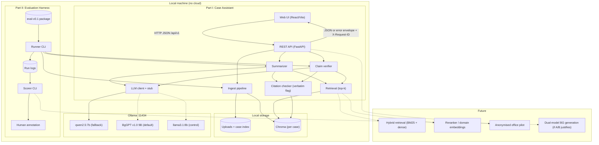

# Product Requirements Document (PRD)

**Project Name:** Legal Document Assistant

**Version:** 1.1

**Date:** 2026-08-18

---

## Revision History

| Version | Date       | Summary |
|---------|------------| --- |
| 1.0     | 2026-07-24 | Initial requirements for the local case assistant (ingest, summarize, verify with citations). |
| 1.1     | 2026-09-18 | Conformance with API v1 (`/api/v1`, error envelope, request id); case lifecycle (empty, uploaded, ingested, stale); citation `verbatim` flag and `{index, quote}` evidence format; stricter upload validation (PDF/TXT only, `%PDF` check); document delete removes its chunks; API 0.2.0 and docker compose setup; updated milestones and tech stack. |

---

## 1. Executive Summary

The Legal Document Assistant is a local research prototype that helps a legal professional or law student work through the documents of a single case. The user creates a case, uploads Bulgarian PDF or TXT files, and the system indexes them locally. On top of that index the system offers two functions:

1. **Summarize:** a short factual summary of the case documents in Bulgarian, where every statement is traceable to retrieved excerpts (citations).
2. **Verify:** a check of a user-supplied factual claim against the case documents, returning `supported`, `denied` or `inconclusive` together with direct quotes.

All processing happens on the user's machine: text extraction, embeddings, the vector store and the language model (served by Ollama). No case content is sent to a cloud LLM API. The system does not give legal advice, does not interpret law and does not draw legal conclusions; the final judgement always stays with the human reader.

The product consists of two parts that share one retrieval pipeline:

- **Part I:** Case Assistant, the interactive application (ingest, summarize, verify).
- **Part II:** Evaluation Harness, a batch protocol that compares three local generators (baseline `qwen2.5:7b`, A/B partner BgGPT v1.0 9B (`s_emanuilov/BgGPT-v1.0:9b`), control `llama3.1:8b`) on a small, versioned Bulgarian evaluation package (eval-v0.1) with constant retrieval parameters.

---

## 2. Goals and Objectives

- Provide a working local pipeline: upload, ingest (extract, chunk, embed, store), summarize with citations, verify a claim with quotes.
- Keep every generated statement traceable to a document, a chunk and a quote the user can inspect.
- Prefer refusal over invention: when retrieved excerpts do not support a claim, the correct verdict is `inconclusive`.
- Run on a consumer machine with about 16 GB of system RAM (one 7B to 8B Q4 model at a time).
- Keep case content, embeddings and the vector index on the local disk; no cloud LLM calls for case content.
- Make the generator a configuration value so that local models can be swapped with constant retrieval parameters.
- Provide a reproducible evaluation protocol on Bulgarian passages that supports the choice of the final generator, without relying on public English leaderboards.
- Remain usable for demos and development when the LLM runtime is unavailable (explicit stub mode, clearly flagged).

---

## 3. System Overview

### Part I: Case Assistant (ingest, summarize, verify)

### 3.1 Functional Components

- **Web UI**
    - Single-page React application for the full flow: create case, upload documents, ingest, summarize, verify.
    - Status panel: API online, Ollama reachable, active model, model pulled or not, embedding backend (`degraded` state shown explicitly).
    - Case status badge (empty, uploaded, ingested, stale) with a re-ingest hint for stale cases.
    - Shows citations next to every summary and verdict, marks non-verbatim quotes, and shows a visible disclaimer that the output is not legal advice.
    - Shows the error code, message and request id when a call fails.
    - UI copy in Bulgarian.
- **REST API**
    - FastAPI service under the versioned prefix `/api/v1` (plus unversioned `/` and `/health`); full list in [api-endpoints.md](./api-endpoints.md).
    - Uniform error envelope `{ error: { code, message, details }, request_id }` for every non-2xx response, with stable snake_case codes.
    - `X-Request-ID` header on every response (echoed or generated) and an access log line per request (`LOG_FORMAT` text or json).
    - `GET /api/v1/health` reports `ok` or `degraded`; `GET /api/v1/models` lists the active and installed models.
    - Interactive OpenAPI documentation at `/docs`.
    - Configuration from environment variables (`.env`, pydantic-settings).
- **Case and Document Storage**
    - JSON case index on disk with case metadata and document records (atomic writes under a lock).
    - Cases can be created, listed, renamed and deleted; deleting a case removes its uploads and its Chroma collection.
    - Uploaded files stored under a per-case directory with `sha256` and size; documents can be deleted individually, which also removes their chunks from Chroma.
    - Accepted formats: `.pdf` and `.txt` only, at most `MAX_UPLOAD_MB` (default 20); a `.pdf` must start with `%PDF`; empty files are rejected. Case documents are Bulgarian only.
    - Case lifecycle: `empty`, `uploaded`, `ingested`, `stale` (documents changed after ingest).
- **Ingest Pipeline**
    - Text extraction (pypdf for PDF, direct read for TXT).
    - Overlapping character chunks (default `CHUNK_SIZE=800`, `CHUNK_OVERLAP=120`).
    - Embeddings: default `sentence-transformers/all-MiniLM-L6-v2` on CPU; optional Ollama `nomic-embed-text`; deterministic `hash_stub` for CI and offline work.
    - One persistent Chroma collection per case; re-ingest rebuilds the collection.
    - Ingest does not require Ollama when the default embedding backend is used; if the configured backend cannot load, ingest falls back to `hash_stub` and reports it.
    - Ingest on a case without documents is rejected (`no_documents`); if no text can be extracted from any document, ingest fails (`ingest_failed`) and the existing index is left untouched.
- **Retrieval**
    - Top-k similarity search over the case collection; shared by summarize and verify. `top_k` is optional per request (range 1 to 20) and falls back to `SUMMARIZE_TOP_K=8` or `VERIFY_TOP_K=5`.
    - The generator only sees retrieved excerpts plus instructions, never the whole case as one prompt.
    - Summarize and verify require a case in status `ingested` or `stale` (`case_not_ingested` otherwise).
- **Summarizer**
    - Retrieves top-k chunks and asks the local LLM for a factual Bulgarian summary as JSON with citation indices.
    - Returns summary text plus structured citations (document, chunk, chunk index, quote, relevance, verbatim flag) and `duration_ms`.
- **Claim Verifier**
    - Retrieves top-k chunks for the claim text (3 to 1000 characters) and asks the local LLM for a JSON verdict: `supported`, `denied` or `inconclusive`, with rationale and supporting and denying evidence as `{index, quote}` pairs (index of the numbered excerpt plus a quote copied from it; legacy index lists are still accepted).
    - Returns supporting quotes, denying quotes and all retrieved quotes for transparency.
- **Citation Checker**
    - Marks each quote `verbatim: true` when it occurs exactly (after whitespace normalisation) in the stored chunk text.
    - Non-verbatim quotes from the LLM are kept but flagged, so the user sees where the model paraphrased.
- **LLM Client**
    - Calls local Ollama `POST /api/generate` (default model `s_emanuilov/BgGPT-v1.0:9b`, BgGPT v1.0 9B; fallback `qwen2.5:7b` for low-memory machines; configurable via `OLLAMA_MODEL`), with `OLLAMA_NUM_CTX=4096` and `OLLAMA_TEMPERATURE=0.0` by default.
    - Bulgarian system prompts; model-specific chat template handling (Mistral-style `[INST] ... [/INST]` for BgGPT).
    - When Ollama is unreachable and `OLLAMA_STUB_ON_UNAVAILABLE=true`, returns a structured stub response flagged `stubbed: true`, with raw chunk excerpts as citations (always verbatim). With stub mode disabled the API returns `503 llm_unavailable`.

### 3.2 Non-Functional Requirements

- **Privacy:** Case content, embeddings and the vector index never leave the machine. External network access is limited to downloading public model weights and public source texts before use.
- **Language scope:** Case documents are Bulgarian only. No English case documents or samples are part of the product.
- **Traceability:** Every citation identifies the document, the chunk and the quoted text, and states whether the quote is verbatim.
- **Observability:** Every response carries a request id that also appears in the logs and in error bodies.
- **API stability:** Endpoints are versioned under `/api/v1`; error codes are part of the contract.
- **Resource budget:** Designed for about 16 GB RAM: one 7B to 8B Q4 generator, CPU embeddings, moderate context (`num_ctx` 4096 by default).
- **Resilience:** Ingest works without Ollama; summarize and verify degrade to flagged stubs instead of failing when stub mode is enabled.
- **Reproducibility:** Chunking, embedding model, top-k, temperature and generator are configuration values and are reported by the health endpoint.
- **Scope safety:** Prompts and UI state that the system does not give legal advice, interpretation, classification or conclusions.
- **Testability:** Automated tests run offline with `hash_stub` embeddings and a mocked Ollama; linting and formatting run in pre-commit hooks and CI.

---

### Part II: Evaluation Harness (eval-v0.1, A/B/control protocol)

### 3.3 Functional Components

- **Evaluation Package (eval-v0.1)**
    - Top-level `eval/eval-v0.1/` with `manifest.json`, `README.md`, `passages/`, `claims/claims.jsonl`, `gold/summaries/` and `LICENSE-NOTES.md` (source licences and attribution).
    - Five planned slots P1 to P5 (see the table below).
    - Current state: the package is a **draft** (not frozen). Passages are author-written Bulgarian demo texts; slot P3 is reserved for a EUR-Lex-Sum Bulgarian excerpt whose `celex_id` is still pending and has no text yet.
- **Manifest**
    - One record per passage with: `id`, `language` (`bg`), `source`, `celex_id` (when applicable), `license` (for example CC-BY-SA 4.0 for EUR-Lex-Sum, or the repository licence for author-written passages), `split`, `retrieved_at`, `file_hash` (SHA-256), `token_count_approx`, `tasks` (`summarize`, `verify`), `notes`.
- **Seed Claims and Gold Evidence**
    - `claims.jsonl` records with `claim_id`, `passage_id`, `language`, `claim_text`, `gold_label` (`SUPPORTED` | `REFUTED` | `NEI`), `gold_evidence` (chunk id or char span plus quote), optional `trap_type`, `annotator_notes`.
    - Gold labels map to API verdicts: `SUPPORTED` to `supported`, `REFUTED` to `denied`, `NEI` to `inconclusive`.
- **Scenarios S1 to S5**
    - Five Bulgarian scenarios over the slots (see the table below); each generator runs all of them on every passage of the frozen package.
- **Runner CLI**
    - `python -m app.eval.run`: loads the manifest, ingests the passages with the shared pipeline, runs summarize and verify for one generator, writes a run log to `eval/runs/` (not versioned).
- **Scorer CLI**
    - `python -m app.eval.score`: computes automatic metrics from run logs (label accuracy, macro-F1, NEI precision/recall, exact quote match, latency) and exports blinded sheets for human annotation.
- **Generators under comparison**
    - Baseline: `qwen2.5:7b` (Ollama tag, about 4.7 GB, Apache 2.0 licence); after the comparison it is the low-memory fallback.
    - A/B: BgGPT v1.0 9B, community Ollama build `s_emanuilov/BgGPT-v1.0:9b` (Q4, about 5.8 GB on disk, Gemma Terms of Use); after the comparison it is the default generator.
    - Control: `llama3.1:8b` (Ollama tag, about 4.9 GB, Llama 3.1 Community License), without official Bulgarian support.
- **Metrics**
    - Faithfulness of summaries (human, Likert 1 to 5, with an error taxonomy: names, dates, numeric thresholds, qualifications, added facts).
    - Coverage of key facts.
    - Citation support (automatic string match per quote plus human judgement of semantic support).
    - Label accuracy (plus macro-F1 and NEI precision/recall).
    - Latency (median of at least three repetitions, end-to-end and generation only).
    - Peak RAM at fixed `num_ctx`.

**Planned passage slots (eval-v0.1)**

| Slot | Profile | Planned source | Role |
| --- | --- | --- | --- |
| P1 | Bulgarian normative excerpt | Author-written or public Bulgarian normative passage, about 200 to 400 tokens | Summarize + supported claims |
| P2 | Bulgarian narrative or multi-document | Author-written Bulgarian narrative or second document of the same matter | Narrative coverage |
| P3 | Long Bulgarian EU legal text | Bulgarian `reference` excerpt from EUR-Lex-Sum with `celex_id` | Summarize + supported / refuted / NEI |
| P4 | Additional Bulgarian passage | Second Bulgarian document of the same matter (not an EN+BG pair) | Multi-document consistency |
| P5 | Bulgarian seed claims | FEVER-style claims over a closed Bulgarian passage | NEI / supported / refuted |

**Scenario matrix (all Bulgarian)**

| Scenario | Context | Focus |
| --- | --- | --- |
| S1 | Short normative (P1) | Supported claims, baseline summarization |
| S2 | Short narrative or multi-document (P2) | Supported + refuted, Bulgarian faithfulness (critical A/B test) |
| S3 | Long EU legal text, chunked (P3) | NEI (fact outside the retrieved context) |
| S4 | Second document of the same matter (P4) | Multi-document fact consistency |
| S5 | Long, chunked (P3/P5) | NEI + fabricated-date trap |

### 3.4 Non-Functional Requirements

- **Reproducibility:** Every run is fully described by its log; the same package, parameters and model tag reproduce the run.
- **Locality:** Evaluation passages are processed through the same local stack; no cloud inference during evaluation.
- **Language scope:** All evaluation passages and claims are Bulgarian. English corpora (BillSum, Multi-LexSum, LexGLUE) remain literature and genre references only.
- **Honesty:** No results are reported before a run on the frozen package. Vendor benchmark numbers are context only and are never merged with local metrics.
- **Licensing of data and models:** Every passage records its licence in the manifest and in `LICENSE-NOTES.md` (for example CC-BY-SA 4.0 with attribution for EUR-Lex-Sum); full protected acts are not republished; model weights are used under their own licences.
- **Feasibility:** A configuration that exhausts memory on the 16 GB profile is reported as infeasible, regardless of quality at smaller input.

### 3.5 Evaluation Rules

- The comparative run only starts on a **frozen** package: manifest status frozen, passage hashes and gold labels locked. Any later change to a passage or label requires a new package version (eval-v0.2 and so on).
- Retrieval and generation parameters stay **constant across generators**: embedding model, chunk size and overlap, `top_k`, temperature (0.0), system prompt and `num_ctx` (4096; an optional separate 8192 series if memory allows).
- The only allowed difference between generators is the chat template: BgGPT must use its Mistral-style `[INST] ... [/INST]` template. A wrong template invalidates the comparison.
- Scenarios S1 to S5 run in the same order for every generator.
- Each run log records: model tag, quantization, `num_ctx`, temperature, `top_k`, chunk size and overlap, embedding backend and model, Ollama version, chat template, package version and manifest hash, prototype git commit, date, per-item latency and the `stubbed` flag. Stubbed outputs are excluded from scoring.
- Human annotation of faithfulness is done on blinded or shuffled outputs (no model name on the annotation sheet).
- **A/B interpretation rule:** if on the Bulgarian scenarios (S1 to S5) BgGPT is better than or equal to Qwen on faithfulness and citation support, BgGPT becomes the default generator. If Qwen is close or better, a single model remains and BgGPT is reported as a competitive alternative. A dual-model variant for Bulgarian generation quality (BgGPT versus Qwen on Bulgarian) is possible if the numbers justify it; routing to English documents is not foreseen.
- Llama stays a control without official Bulgarian support; weak Bulgarian results for it are expected and are not read as a failure of the whole architecture.

---

## 4. Data Flow Overview

### Part I Flow:

1. User creates a case in the web UI.
2. User uploads one or more Bulgarian PDF or TXT files; the API stores them on disk and records them in the case index.
3. User triggers ingest; the API extracts text, chunks it, embeds each chunk and writes the chunks to the case's Chroma collection.
4. User requests a summary; the API retrieves the top-k chunks, calls the local LLM and returns a summary with citations.
5. User submits a claim; the API retrieves the top-k chunks for the claim, calls the local LLM and returns a verdict with supporting, denying and retrieved quotes.
6. The citation checker flags every quote as verbatim or not before the response is returned.
7. User reviews the citations and decides whether to accept or reject the output.
8. If the user later uploads or deletes a document, the case becomes `stale`; summarize and verify still work on the previous index until the user re-ingests.

### Part II Flow:

1. Complete the passages, seed claims and gold evidence of eval-v0.1 and record hashes in the manifest.
2. Freeze the package (status frozen) before the first comparative run.
3. Fix the retrieval parameters and `num_ctx`, and pull or import the three generators.
4. For each generator, the runner ingests the passages, runs S1 to S5 in the same order and writes a run log.
5. The scorer computes automatic metrics from the logs and exports blinded annotation sheets.
6. Annotate faithfulness and citation support on the blinded outputs.
7. Tabulate results per scenario and apply the A/B interpretation rule.

---

## 5. Technical Architecture

### Tech Stack

- **Frontend:** React 19.2.8, TypeScript 5.8.3, Vite 8.3.1 (`@vitejs/plugin-react` 6.1.1), plain CSS; dev server on port 5173 proxies `/api` to port 8000
- **Frontend tooling:** ESLint 9.39.5 (flat config, typescript-eslint 8.71.0), Prettier 3.9.9
- **Backend:** Python 3.12 to 3.13, FastAPI 0.115.6, uvicorn 0.34.0, pydantic 2.10.5, pydantic-settings 2.7.1, python-multipart 0.0.20, httpx 0.28.1, python-dotenv 1.0.1
- **Text extraction:** pypdf 5.1.0
- **Vector store:** Chroma 1.0.20 (`PersistentClient`, on disk)
- **Embeddings:** sentence-transformers 3.3.1 with `all-MiniLM-L6-v2` on CPU; optional Ollama `nomic-embed-text`; `hash_stub`
- **LLM runtime:** Ollama on `127.0.0.1:11434`; models `s_emanuilov/BgGPT-v1.0:9b` (default, BgGPT v1.0 9B), `qwen2.5:7b` (fallback), `llama3.1:8b` (evaluation control)
- **Evaluation:** Python CLI inside the backend package (`python -m app.eval.run`, `python -m app.eval.score`), JSON and JSONL artefacts
- **Backend tooling:** pytest 8.3.4, pytest-asyncio 0.25.0, ruff 0.16.9, pre-commit 4.6.2
- **Packaging:** optional docker compose setup (web UI on port 8080 served by nginx, which proxies `/api` to `backend:8000`; Ollama service on 11434); everything still runs on the local machine
- **API version:** 0.2.0 (reported by `/` and `/api/v1/health`)

Related documents: [architecture-diagrams.md](./architecture-diagrams.md) (Mermaid diagrams) and [api-endpoints.md](./api-endpoints.md) (API v1 reference).

---

## 6. Milestones

| Milestone | Target Date | Status |
| --- | --- | --- |
| Requirements Finalization | 2026-07-10 | Done |
| Architecture & API Design | 2026-07-24 | Done |
| Ingest Pipeline MVP | 2026-08-07 | Done |
| Summarize / Verify with Citations | 2026-08-21 | Done |
| Web UI | 2026-09-04 | Done |
| API v1 Hardening + Tooling | 2026-09-18 | Done |
| Evaluation Harness | 2026-09-25 | In progress (package is a draft) |
| Evaluation Run on Frozen eval-v0.1 | Pending | Pending |
| Thesis Submission | Per department schedule | Planned |

---

## 7. Out of Scope

- Legal advice, legal interpretation, legal classification of cases, legal conclusions.
- Building legal timelines or chronologies as an analytical product.
- Cloud LLM APIs for case content, including masked or anonymised case content.
- Non-Bulgarian case documents and English evaluation passages.
- Real office case files with personal data in the public evaluation.
- Multi-user accounts, authentication, remote hosting.
- OCR for scanned PDFs and complex layouts.
- Fine-tuning of generators or embeddings.
- Models above the 16 GB profile (70B class, Mixtral 8x7B, BgGPT 27B).

---

## 8. Future Enhancements

- Hybrid retrieval (BM25 plus dense embeddings).
- Domain-specific embeddings or a reranker.
- Dual-model setup for Bulgarian generation (BgGPT versus Qwen) if the A/B protocol justifies it.
- Stricter post-hoc citation checking.
- Extended Bulgarian evaluation (eval-v0.2) with more passages and double annotation.
- Pilot with anonymised office documents, kept outside the public evaluation.
- OCR for scanned documents.

---

Flowchart Design

