# Legal Document Assistant - Architecture Diagrams

System Architecture Overview

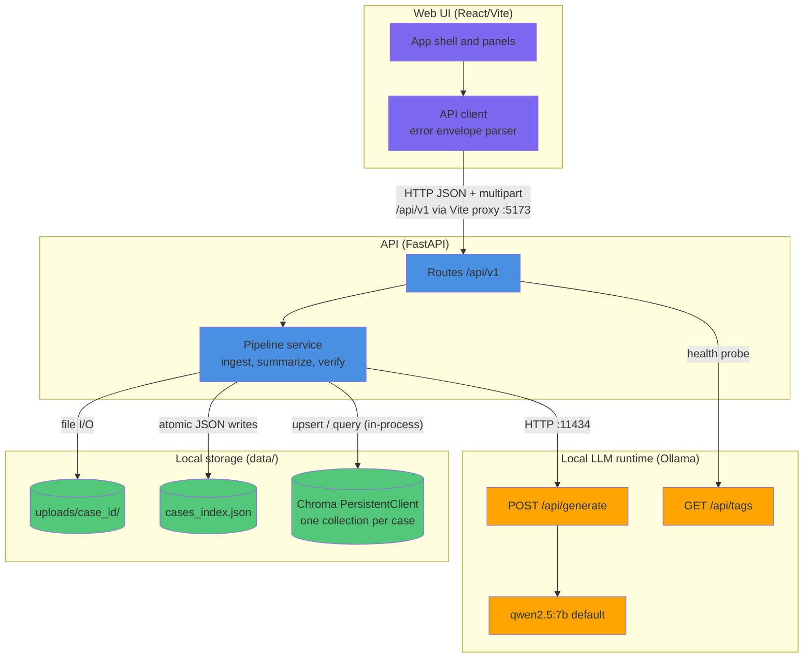

## Component Interaction Diagram - Ingest

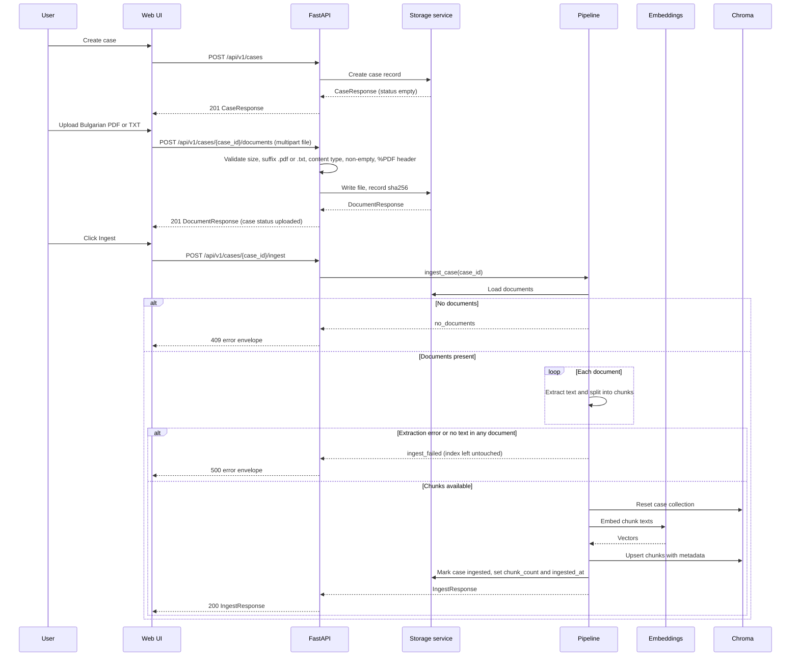

## Component Interaction Diagram - Summarize

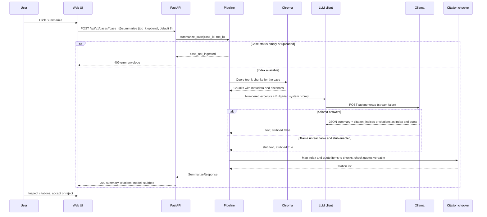

## Component Interaction Diagram - Verify

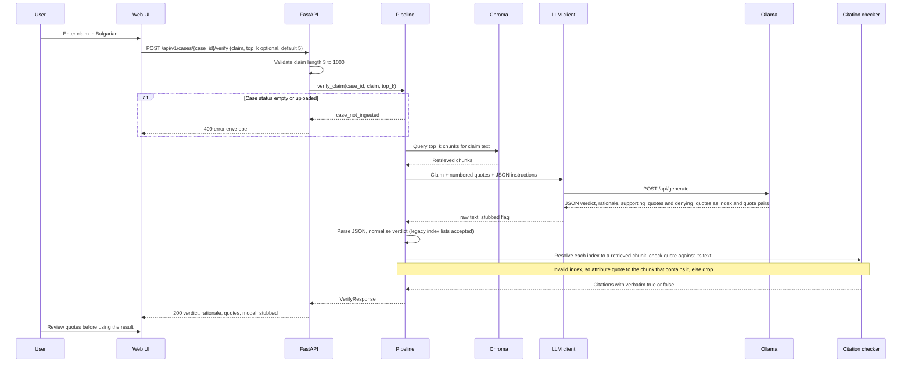

## Data Model Diagram

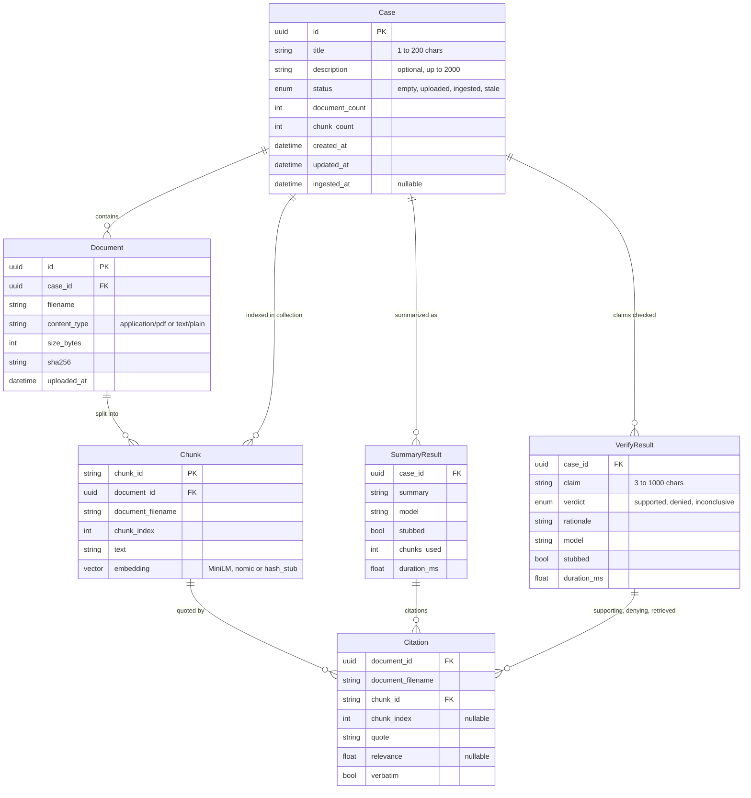

## Evaluation Data Model Diagram

Evaluation artefacts are JSON and JSONL files under `eval/`, not database tables. Source licences are recorded per passage in the manifest `license` field and summarised in `LICENSE-NOTES.md`. Run logs are written to `eval/runs/` and are not versioned.

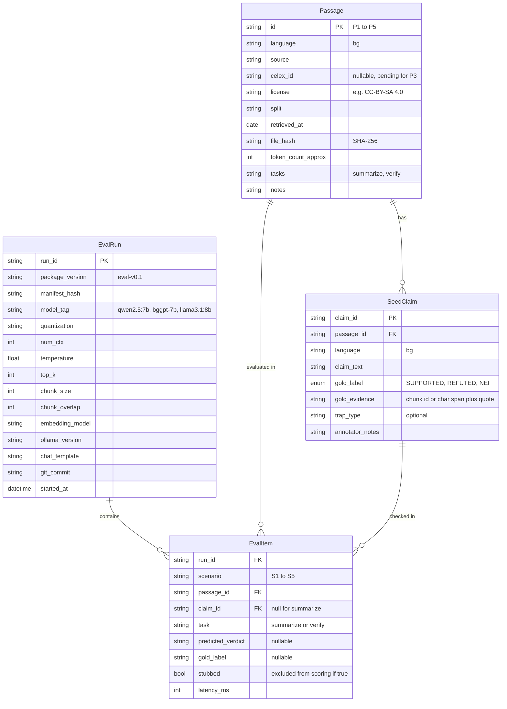

## Data Flow Diagram - Document Upload Validation

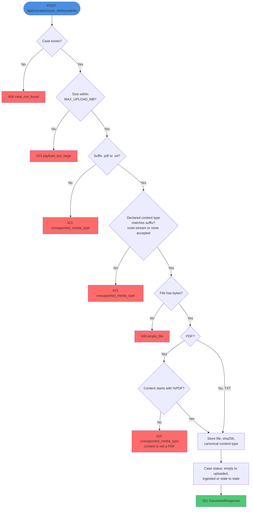

## Data Flow Diagram - Ingest

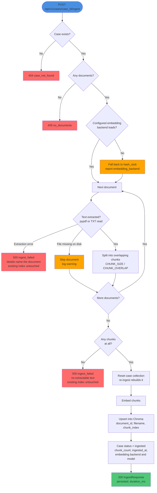

## Data Flow Diagram - Verify

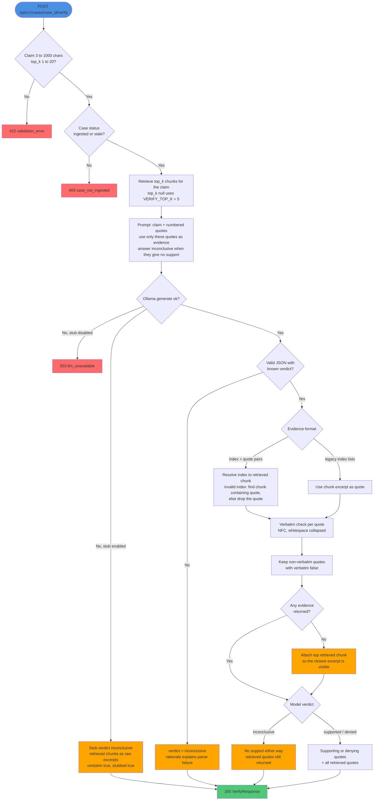

## Case Lifecycle State Diagram

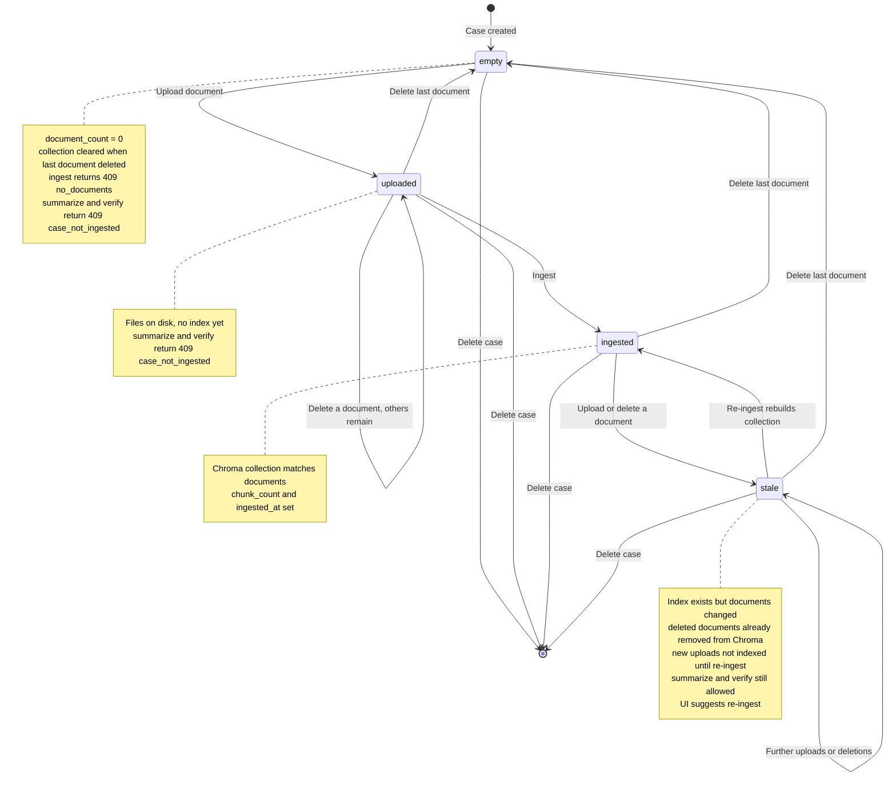

## Service and Deployment Architecture

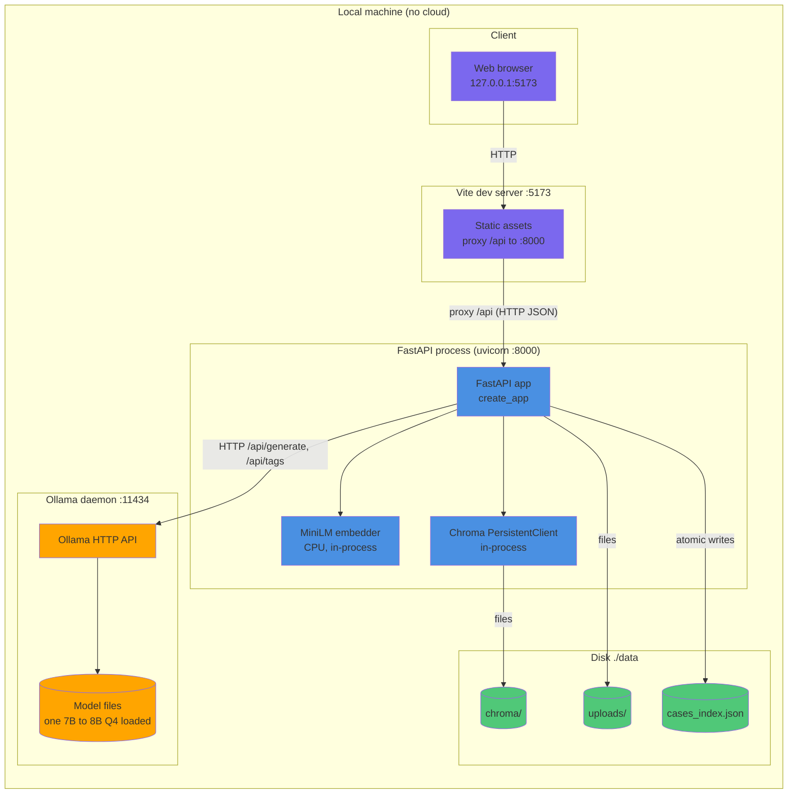

## Docker Compose Deployment (optional)

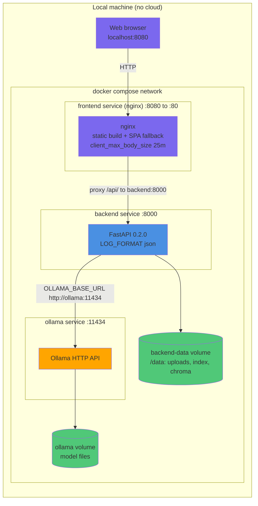

Models are pulled once inside the Ollama container (`docker compose exec ollama ollama pull qwen2.5:7b`). Ports 8000 and 11434 are also published on the host for the OpenAPI docs and diagnostics.

## Error Handling and Stub Fallback Flow

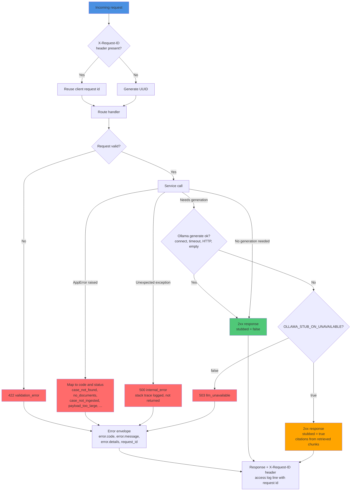

## Model Switching and A/B Evaluation Flow

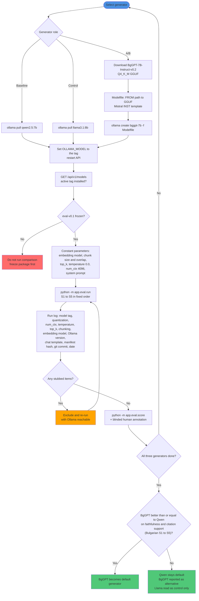

## Backend Module Dependency Graph

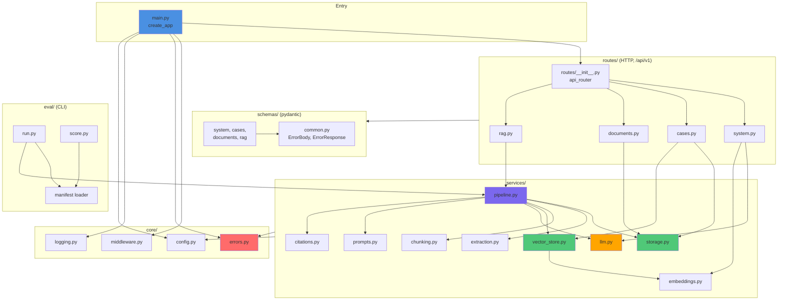

## Memory Budget Note (about 16 GB RAM)

Qualitative view; measured peak RAM belongs to the evaluation protocol and is not stated here.

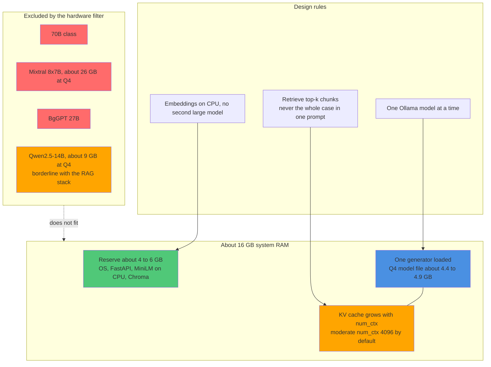
